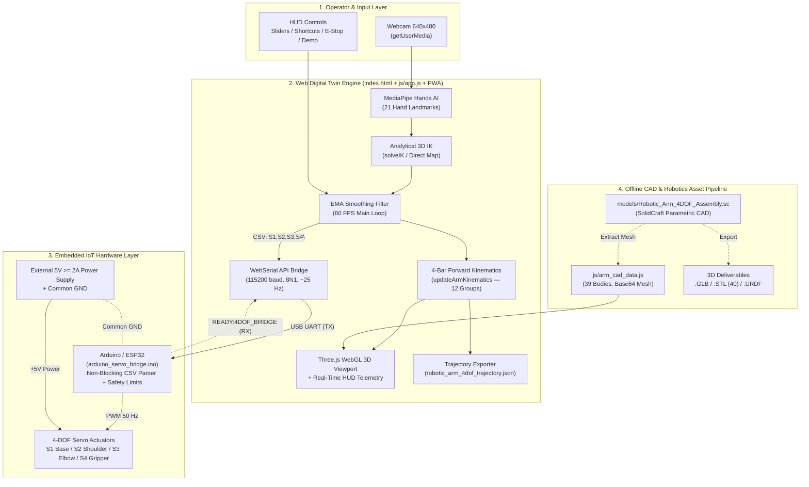

# เอกสารทะเบียนไฟล์และสถาปัตยกรรมเชิงเทคนิค — Group01_Project

> **รายวิชา:** ISY49303 IoT | **โปรเจกต์:** 4-DOF Robotic Arm Digital Twin (Hand Tracking & IoT WebSerial)  
> **สรุปขนาดโปรเจกต์:** 74 ไฟล์ (9.38 MB) | **บทบาทเอกสารนี้:** แหล่งอ้างอิงกลาง (Single Source of Truth) สำหรับทะเบียนไฟล์ทั้งหมด สถาปัตยกรรม Data Flow จลนศาสตร์ 4-Bar โปรโตคอล Serial และแนวทางส่งมอบ *(สำหรับคู่มือเริ่มต้นใช้งาน, Pinout และ Troubleshooting ดูที่ [`README.md`](./README.md))*

**สารบัญ (Table of Contents):**
[1. ตารางสรุปไฟล์ทั้งหมด (5 หมวดมาตรฐานสากล)](#1-ตารางสรุปไฟล์ทั้งหมด-เรียงตามหมวดหมู่มาตรฐานสากล) • [2. สถาปัตยกรรมระบบและเส้นทางข้อมูล](#2-สถาปัตยกรรมภาพรวมและเส้นทางข้อมูลเชิงเทคนิค-system-architecture--data-flow) • [3. จลนศาสตร์ 4-Bar และโปรโตคอล Serial](#3-ระบบพิกัด-จลนศาสตร์-4-bar-และโปรโตคอล-usb-serial) • [4. มาตรฐานโค้ดและการส่งออก](#4-มาตรฐานโค้ดและการส่งออกผลลัพธ์พร้อมใช้งาน)

---

## 1. ตารางสรุปไฟล์ทั้งหมด เรียงตามหมวดหมู่มาตรฐานสากล

### หมวดที่ 1: เอกสารและแผนภาพ (Documentation & Diagrams) — 19 ไฟล์
| ลำดับ | ไฟล์ / โฟลเดอร์ | หน้าที่โดยสรุป |
| :---: | :--- | :--- |
| 1 | [`README.md`](./README.md) | คู่มือเริ่มต้นใช้งาน (Quick Start), ตาราง Pinout, การควบคุม และการแก้ปัญหาเบื้องต้น |
| 2 | [`PROJECT_DOCUMENTATION.md`](./PROJECT_DOCUMENTATION.md) | ทะเบียนไฟล์ทั้งหมด 74 ไฟล์ และเอกสารอ้างอิงเชิงเทคนิคกลาง (ไฟล์นี้) |
| 3 | [`docs/WIRING_GUIDE.md`](./docs/WIRING_GUIDE.md) | คู่มือต่อวงจรฮาร์ดแวร์, รายการอุปกรณ์ (BOM), ขา Pin ESP32, ไฟ 5V แยก และ Common GND |
| 4 | [`docs/images/`](./docs/images/) *(16 ไฟล์)* | แผนภาพสถาปัตยกรรม, OSI/TCP-IP และ Data Flow 8 ชุด (`.png` + `.svg`) สำหรับเอกสารและสไลด์ |

<details>
<summary>📂 ดูรายการไฟล์ย่อยทั้งหมดใน <code>docs/images/</code> (16 ไฟล์ — 8 ชุดภาพ .png / .svg)</summary>

| ชุด | ไฟล์ภาพ Raster (`.png`) | ไฟล์เวกเตอร์ (`.svg`) | เนื้อหาแผนภาพ |
| :---: | :--- | :--- | :--- |
| 01 | [`01_system_data_flow.png`](./docs/images/01_system_data_flow.png) | [`01_system_data_flow.svg`](./docs/images/01_system_data_flow.svg) | เส้นทางข้อมูลภาพรวมของระบบ (System Data Flow) |
| 02 | [`02_runtime_realtime_sequence.png`](./docs/images/02_runtime_realtime_sequence.png) | [`02_runtime_realtime_sequence.svg`](./docs/images/02_runtime_realtime_sequence.svg) | ลำดับการทำงานแบบ Real-Time (Runtime Sequence) |
| 03 | [`03_osi_tcpip_data_flow.png`](./docs/images/03_osi_tcpip_data_flow.png) | [`03_osi_tcpip_data_flow.svg`](./docs/images/03_osi_tcpip_data_flow.svg) | เปรียบเทียบการไหลของข้อมูลตามโมเดล OSI และ TCP/IP |
| 04 | [`04_osi_model_slide.png`](./docs/images/04_osi_model_slide.png) | [`04_osi_model_slide.svg`](./docs/images/04_osi_model_slide.svg) | สไลด์อธิบายโครงสร้าง OSI 7 Layers ของโปรเจกต์ |
| 05 | [`05_tcpip_model_slide.png`](./docs/images/05_tcpip_model_slide.png) | [`05_tcpip_model_slide.svg`](./docs/images/05_tcpip_model_slide.svg) | สไลด์อธิบายโครงสร้าง TCP/IP Model ของโปรเจกต์ |
| 06 | [`06_system_architecture_slide.png`](./docs/images/06_system_architecture_slide.png) | [`06_system_architecture_slide.svg`](./docs/images/06_system_architecture_slide.svg) | สไลด์สถาปัตยกรรมระบบ Digital Twin และ IoT |
| 07 | [`07_realtime_runtime_flow_slide.png`](./docs/images/07_realtime_runtime_flow_slide.png) | [`07_realtime_runtime_flow_slide.svg`](./docs/images/07_realtime_runtime_flow_slide.svg) | สไลด์ลูปประมวลผล 60 FPS และ WebSerial 25 Hz |
| 08 | [`08_end_to_end_data_flow_slide.png`](./docs/images/08_end_to_end_data_flow_slide.png) | [`08_end_to_end_data_flow_slide.svg`](./docs/images/08_end_to_end_data_flow_slide.svg) | สไลด์เส้นทางข้อมูลตั้งแต่กล้องถึง Servo (End-to-End) |

</details>

### หมวดที่ 2: การตั้งค่าและสคริปต์เปิดระบบ (Configuration & Launcher) — 3 ไฟล์
| ลำดับ | ไฟล์ / โฟลเดอร์ | หน้าที่โดยสรุป |
| :---: | :--- | :--- |
| 5 | [`.gitignore`](./.gitignore) | กำหนดข้อยกเว้นไม่ให้นำไฟล์ขยะ OS/IDE/Python/Log ขึ้น Git |
| 6 | [`.gitattributes`](./.gitattributes) | มาตรฐาน Line Endings ข้ามแพลตฟอร์ม (`LF` สำหรับโค้ด, `CRLF` สำหรับ `.bat`, `binary` สำหรับโมเดล/ภาพ) |
| 7 | [`start_digital_twin.bat`](./start_digital_twin.bat) | สคริปต์ Windows เปิด Python HTTP Server (`127.0.0.1:8080`) และเปิดเบราว์เซอร์เพื่อให้ได้ Secure Context |

### หมวดที่ 3: เว็บแอปพลิเคชัน Digital Twin & PWA (Web Frontend) — 7 ไฟล์
| ลำดับ | ไฟล์ / โฟลเดอร์ | หน้าที่โดยสรุป |
| :---: | :--- | :--- |
| 8 | [`index.html`](./index.html) | หน้าเว็บหลักและโครงสร้าง HUD 6 ส่วน (ฉาก 3D, แถบสถานะ, แผงกล้อง/CAD, แผงควบคุม 4-DOF, Mobile Nav, สคริปต์) |
| 9 | [`css/style.css`](./css/style.css) | ธีม Dark-Mode Glassmorphism, Responsive (Desktop/Tablet/Mobile) และมาตรฐาน WCAG 2.1 AA |
| 10 | [`js/app.js`](./js/app.js) | สมองหลัก: Three.js 3D, 4-Bar FK/IK, MediaPipe Hand Tracking, EMA Filter, Demo/Recorder, E-Stop, 2-Way WebSerial |
| 11 | [`js/arm_cad_data.js`](./js/arm_cad_data.js) | ข้อมูลเรขาคณิต CAD 39 ชิ้น (18,080 สามเหลี่ยม) เข้ารหัส Base64 สำหรับเรนเดอร์ 3D ในเว็บ *(สร้างอัตโนมัติจาก `.sc` ไม่ควรแก้ด้วยมือ)* |
| 12 | [`manifest.json`](./manifest.json) | ไฟล์ตั้งค่า Progressive Web App (PWA) สำหรับติดตั้งเป็นแอปบนเดสก์ท็อปและมือถือ |
| 13 | [`sw.js`](./sw.js) | Service Worker แคชไฟล์หลักแบบ Network-First เพื่อรองรับ PWA และการใช้งานออฟไลน์ |
| 14 | [`assets/icon.svg`](./assets/icon.svg) | ไอคอนเวกเตอร์สำหรับ Favicon และไอคอนแอป PWA |

### หมวดที่ 4: เฟิร์มแวร์ไมโครคอนโทรลเลอร์ (IoT Firmware) — 2 ไฟล์
| ลำดับ | ไฟล์ / โฟลเดอร์ | หน้าที่โดยสรุป |
| :---: | :--- | :--- |
| 15 | [`arduino_servo_bridge/arduino_servo_bridge.ino`](./arduino_servo_bridge/arduino_servo_bridge.ino) | เฟิร์มแวร์ใช้งานจริง (Arduino/ESP32) รับ CSV `S1,S2,S3,S4\n` ที่ 115200 baud แบบ Non-blocking พร้อม Safety Limits ขับ Servo 4 แกน |
| 16 | [`servo_test_esp32/servo_test_esp32.ino`](./servo_test_esp32/servo_test_esp32.ino) | เฟิร์มแวร์ทดสอบ Servo 4 ตัว (2×MG90S + 2×SG90) บน ESP32 และตั้งค่า Home `90°` ก่อนประกอบแขนกลจริง |

### หมวดที่ 5: โมเดล 3 มิติและไฟล์หุ่นยนต์ (CAD & Robotics Models) — 43 ไฟล์
| ลำดับ | ไฟล์ / โฟลเดอร์ | หน้าที่โดยสรุป |
| :---: | :--- | :--- |
| 17 | [`models/Robotic_Arm_4DOF_Assembly.sc`](./models/Robotic_Arm_4DOF_Assembly.sc) | ไฟล์ต้นฉบับ Parametric CAD (SolidCraft) ใช้สกัดไฟล์ 3D อื่น ๆ ทั้งหมด |
| 18 | [`models/Robotic_Arm_4DOF_Assembly.glb`](./models/Robotic_Arm_4DOF_Assembly.glb) | โมเดล 3D สำเร็จรูปมาตรฐาน glTF 2.0 Binary (สำหรับ 3D Viewer และดาวน์โหลดจากหน้าเว็บ) |
| 19 | [`models/Robotic_Arm_4DOF.urdf`](./models/Robotic_Arm_4DOF.urdf) | ไฟล์นิยามหุ่นยนต์ XML (URDF) แปลงสเกล `0.001` เป็นเมตรสำหรับ ROS / Gazebo / PyBullet |
| 20 | [`models/stl/`](./models/stl/) *(39 ชิ้นแยก + 1 ชิ้นเต็ม)* | ไฟล์ Binary STL หน่วย mm สำหรับพิมพ์ 3D และอ้างอิงใน URDF (ดูรายการครบ 40 ไฟล์ด้านล่าง) |

<details>
<summary>📂 ดูรายการไฟล์ย่อยทั้งหมดใน <code>models/stl/</code> (40 ไฟล์ — 39 ชิ้นส่วนแยก + 1 ชิ้นประกอบเต็ม)</summary>

* **กลุ่มฐานและแท่นหมุน (Base & Turntable — 17 ชิ้น):**
  [`00_Asm_01_Main_Base_Plate.stl`](./models/stl/00_Asm_01_Main_Base_Plate.stl) • [`01_Standoff_M3_1.stl`](./models/stl/01_Standoff_M3_1.stl) • [`02_Standoff_M3_2.stl`](./models/stl/02_Standoff_M3_2.stl) • [`03_Standoff_M3_3.stl`](./models/stl/03_Standoff_M3_3.stl) • [`04_Standoff_M3_4.stl`](./models/stl/04_Standoff_M3_4.stl) • [`05_Asm_02_Base_Servo_Plate.stl`](./models/stl/05_Asm_02_Base_Servo_Plate.stl) • [`06_Asm_03_Servo_Collar_Base.stl`](./models/stl/06_Asm_03_Servo_Collar_Base.stl) • [`07_Servo_1_Base_Yaw.stl`](./models/stl/07_Servo_1_Base_Yaw.stl) • [`08_Asm_04_Turntable_Bottom.stl`](./models/stl/08_Asm_04_Turntable_Bottom.stl) • [`09_Asm_05_Turntable_Left_Wall.stl`](./models/stl/09_Asm_05_Turntable_Left_Wall.stl) • [`10_Asm_06_Turntable_Right_Wall.stl`](./models/stl/10_Asm_06_Turntable_Right_Wall.stl) • [`11_Asm_03_Servo_Collar_Shoulder.stl`](./models/stl/11_Asm_03_Servo_Collar_Shoulder.stl) • [`12_Servo_2_Shoulder.stl`](./models/stl/12_Servo_2_Shoulder.stl) • [`13_Asm_03_Servo_Collar_Elbow.stl`](./models/stl/13_Asm_03_Servo_Collar_Elbow.stl) • [`14_Servo_3_Elbow.stl`](./models/stl/14_Servo_3_Elbow.stl) • [`15_Asm_07_Turntable_Brace_Back.stl`](./models/stl/15_Asm_07_Turntable_Brace_Back.stl) • [`16_Asm_07_Turntable_Brace_Front.stl`](./models/stl/16_Asm_07_Turntable_Brace_Front.stl)
* **กลุ่มแขนท่อนบน กลไก 4-Bar และแขนท่อนล่าง (Upper Arm, 4-Bar & Forearm — 15 ชิ้น):**
  [`17_Asm_08_Upper_Main_Arm_L.stl`](./models/stl/17_Asm_08_Upper_Main_Arm_L.stl) • [`18_Asm_09_Upper_Main_Arm_R.stl`](./models/stl/18_Asm_09_Upper_Main_Arm_R.stl) • [`19_Asm_15_Upper_Cross_Spacer_1.stl`](./models/stl/19_Asm_15_Upper_Cross_Spacer_1.stl) • [`20_Asm_15_Upper_Cross_Spacer_2.stl`](./models/stl/20_Asm_15_Upper_Cross_Spacer_2.stl) • [`21_Asm_10_Upper_Parallel_Link.stl`](./models/stl/21_Asm_10_Upper_Parallel_Link.stl) • [`22_Asm_11_Triangle_Bellcrank.stl`](./models/stl/22_Asm_11_Triangle_Bellcrank.stl) • [`23_Asm_12_Elbow_Push_Rod.stl`](./models/stl/23_Asm_12_Elbow_Push_Rod.stl) • [`24_Asm_13_Forearm_Main_Link_L.stl`](./models/stl/24_Asm_13_Forearm_Main_Link_L.stl) • [`25_Asm_13_Forearm_Main_Link_R.stl`](./models/stl/25_Asm_13_Forearm_Main_Link_R.stl) • [`26_Asm_15_Forearm_Cross_Spacer_3.stl`](./models/stl/26_Asm_15_Forearm_Cross_Spacer_3.stl) • [`27_Asm_14_Forearm_Parallel_Link.stl`](./models/stl/27_Asm_14_Forearm_Parallel_Link.stl) • [`28_Pin_Shoulder.stl`](./models/stl/28_Pin_Shoulder.stl) • [`29_Pin_Elbow.stl`](./models/stl/29_Pin_Elbow.stl) • [`30_Pin_Bellcrank_Top.stl`](./models/stl/30_Pin_Bellcrank_Top.stl) • [`31_Pin_Wrist.stl`](./models/stl/31_Pin_Wrist.stl)
* **กลุ่มหัวคีบ (Gripper — 7 ชิ้น):**
  [`32_Asm_16_Gripper_Top_Mount.stl`](./models/stl/32_Asm_16_Gripper_Top_Mount.stl) • [`33_Asm_17_Gripper_Bottom_Plate.stl`](./models/stl/33_Asm_17_Gripper_Bottom_Plate.stl) • [`34_Asm_03_Servo_Collar_Gripper.stl`](./models/stl/34_Asm_03_Servo_Collar_Gripper.stl) • [`35_Servo_4_Gripper.stl`](./models/stl/35_Servo_4_Gripper.stl) • [`36_Asm_18_Gripper_Claw_Left.stl`](./models/stl/36_Asm_18_Gripper_Claw_Left.stl) • [`37_Asm_19_Gripper_Claw_Right.stl`](./models/stl/37_Asm_19_Gripper_Claw_Right.stl) • [`38_Asm_20_Gripper_Drive_Link.stl`](./models/stl/38_Asm_20_Gripper_Drive_Link.stl)
* **ไฟล์ประกอบเต็ม (Full Assembly — 1 ชิ้น):**
  [`Robotic_Arm_4DOF_Assembly_Full.stl`](./models/stl/Robotic_Arm_4DOF_Assembly_Full.stl)

</details>

---

## 2. สถาปัตยกรรมภาพรวมและเส้นทางข้อมูลเชิงเทคนิค (System Architecture & Data Flow)

### 2.1 แผนภาพสถาปัตยกรรมระบบภาพรวม (System Architecture Diagram)



### 2.2 Runtime Control Pipeline (60 FPS Render / 25 Hz WebSerial)
| ขั้น | ต้นทาง | ไฟล์ → ฟังก์ชันหลัก | ข้อมูล (Payload / State) | ปลายทาง |
| :---: | :--- | :--- | :--- | :--- |
| **1** | โหลดเรขาคณิต | `js/arm_cad_data.js` → `js/app.js` (`b64ToFloat32`, SEC 04) | Base64 → `Float32Array` → 39 `THREE.Mesh` ใน 12 กลุ่มกลไก | `groupMap` (`cadRoot`) |
| **2A** | กล้องเว็บแคม | `js/app.js` (`onHandResults` → `solveIK`, SEC 11/07) | ภาพ 640×480 → 21 Landmarks → `(tx, ty, tz)` + Pinch | `state.target` |
| **2B** | UI / Demo / Play | `index.html` → `js/app.js` (SEC 08/09/12) | Sliders, Pick & Place, Circle IK, `recordedFrames[i]` | `state.target` |
| **3** | กรองสัญญาณ | `js/app.js` (`animate` EMA Filter, SEC 12) | `current += (target - current) * smoothing` | `state.current` |
| **4A** | เรนเดอร์ 3D & HUD | `js/app.js` (`updateArmKinematics`, `updateJointLabels`) | มุม 12 กลุ่มกลไก, พิกัด `TCP (mm)`, ฟิสิกส์หยิบกล่อง | WebGL & HUD |
| **4B** | ส่งคำสั่ง IoT | `js/app.js` (`sendSerialTelemetry`, SEC 10) | CSV `"S1,S2,S3,S4\n"` (`0..180`) ทุก ~40 ms (`25 Hz`) | USB WebSerial |
| **5** | ขับมอเตอร์จริง | `arduino_servo_bridge.ino` (`loop` → `writeAllServos`) | Non-blocking buffer → `sscanf` → Safety Limits → PWM | Servo 4 ตัว |
| **6** | ส่งออกเส้นทาง | `js/app.js` (`#btn-export-traj`, SEC 09) | JSON (`model`, `timestamp`, `current_pose`, `recorded_frames`) | `robotic_arm_4dof_trajectory.json` |

### 2.3 CAD Asset Pipeline
ต้นฉบับ [`Robotic_Arm_4DOF_Assembly.sc`](./models/Robotic_Arm_4DOF_Assembly.sc) ถูกสกัดเป็น 4 รูปแบบพร้อมใช้งาน:
* `js/arm_cad_data.js` (Base64 Mesh สำหรับเว็บ) • `models/Robotic_Arm_4DOF_Assembly.glb` (glTF 2.0) • `models/stl/*.stl` (40 ไฟล์ หน่วย mm สำหรับพิมพ์ 3D/URDF) • `models/Robotic_Arm_4DOF.urdf` (XML สเกล `0.001` เป็นเมตรสำหรับ ROS/Gazebo/PyBullet)

---

## 3. ระบบพิกัด จลนศาสตร์ 4-Bar และโปรโตคอล USB Serial

* **การแปลงพิกัด (CAD Z-up → Three.js Y-up):** หมุนกลุ่มราก `cadRoot.rotation.x = -Math.PI / 2` เพื่อแปลงแกน `+Z` ของ SolidCraft (mm) ให้ชี้ขึ้นตาม `+Y` ของ Three.js
* **มิติและจุดหมุนหลัก (Home Pose, mm):** `L1 = 80.0`, `L2 = 80.0`, `TCP Offset ≈ 76.6`  
  `yaw: [-28.0, 0, 29.0]` • `shoulder: [-28.0, 0, 64.0]` • `elbow: [5.809, 0, 136.505]` • `wrist: [85.371, 0, 128.142]`
* **โปรโตคอล USB Serial:** `115200 baud`, `8N1`, สูงสุด `25 Hz` (เว้นระยะ `≥40 ms`), แพ็กเก็ต `"S1,S2,S3,S4\n"` (บอร์ดตอบกลับ `"READY:4DOF_BRIDGE"` เมื่อพร้อม)
* **สูตรแปลงค่าควบคุม → องศา Servo (`0..180°`):**
  * `S1 = clamp(round(90 + j1), 0, 180)` *(ช่วง `j1`: `-90°..+90°`)*
  * `S2 = clamp(round(90 + j2), 0, 180)` *(ช่วง `j2`: `-45°..+65°`)*
  * `S3 = clamp(round(90 + j3), 0, 180)` *(ช่วง `j3`: `-55°..+55°`)*
  * `S4 = clamp(round((j4 / 100) * 180), 0, 180)` *(ช่วง `j4`: `0..100%`; เฟิร์มแวร์ map เข้าช่วงปลอดภัย `20°..120°`)*

---

## 4. มาตรฐานโค้ดและการส่งออกผลลัพธ์พร้อมใช้งาน

* **มาตรฐานโค้ด:** ทุกไฟล์มี Header (`@file`, `@project`, `@description`, `@data_flow`) และแบ่งหมวดตรงกัน (`index.html`/`css/style.css` หมวด `01`–`05`, `js/app.js` `SECTION 01`–`12` + JSDoc, `.ino` + Doxygen)
* **ส่งออกแพ็กเกจ `.zip` สะอาดสำหรับส่งงาน (ไม่ติด `.git/` และไฟล์ขยะ):**
  ```powershell
  git archive --format=zip --prefix=Group01_Project/ HEAD -o Group01_Project_ISY49303_Ready.zip
  ```
* **เผยแพร่ออนไลน์ (GitHub Pages):** Push ขึ้น branch `main` แล้วเปิด **Settings → Pages → Deploy from a branch (`main` / `/ (root)`)** เพื่อให้ใช้งานกล้องและ WebSerial ผ่าน HTTPS ได้ทันที
