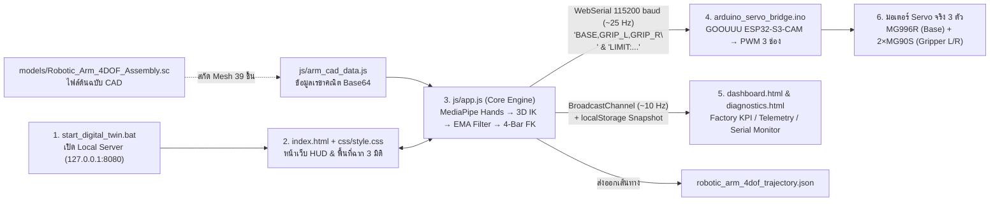

# 4-DOF Robotic Arm Digital Twin (Hand Tracking & IoT WebSerial)

> **รายวิชา:** ISY49303 IoT | **กลุ่ม:** Group 01 (`Group01_Project`)
> **ประเภทงาน:** ระบบแขนกล 4 แกน (4-Bar Parallel Linkage) แบบ Hybrid Digital Twin บนเว็บ ควบคุมด้วยมือผ่านกล้องเว็บแคม (MediaPipe Hands) และส่งคำสั่งควบคุมฮาร์ดแวร์จริง **3 Servo (`1×MG996R` ฐาน + `2×MG90S` มือหนีบแยกซ้าย/ขวา)** ผ่าน USB WebSerial ไปยังบอร์ด **GOOUUU ESP32-S3-CAM** (พร้อมคงการจำลองขยับขึ้น-ลงของ Shoulder/Elbow บน 3D และ Dashboard ครบถ้วน)

---

## 1. ภาพรวมเส้นทางข้อมูลของระบบ (File-Level Data Flow)

แผนภาพด้านล่างแสดงลำดับการทำงานและการส่งต่อข้อมูลระหว่างไฟล์ทั้งหมดในโปรเจกต์ตั้งแต่เปิดโปรแกรมจนถึงการขับมอเตอร์ Servo จริง:

### หน้าต่างการทำงานทั้ง 3 หน้า (Multi-Page Control Room)
* **`index.html` (🧊 3D Control):** หน้าควบคุมหลัก แสดงแขนกล 3D, MediaPipe Hand Tracking, Inverse/Forward Kinematics, ตั้งค่าขอบเขต Servo และเชื่อมต่อ USB WebSerial
* **`dashboard.html` (📊 Factory Dashboard):** แดชบอร์ดโรงงานแสดง KPI, OEE, Cycle Count, กราฟ Real-Time 4-DOF Servo Telemetry (HTML5 Canvas ล้วน ออฟไลน์ได้), เกจข้อต่อ + พิกัด TCP และ Event/Alarm Log พร้อมส่งออก CSV
* **`diagnostics.html` (🔧 IoT Diagnostics):** หน้าตรวจสอบฮาร์ดแวร์ แสดง Live Serial & Protocol Monitor, ตาราง Joint Safety Limits เทียบ Hard Limits, ผังขา Pin Arduino/ESP32 และส่งออก Diagnostics JSON
* **การนำทาง (ปุ่มเมนู `☰` มุมซ้ายบน):** คลิกชื่อหน้าเพื่อสลับในแท็บเดิม (หากกล้องหรือ USB ทำงานอยู่บนหน้าหลัก ระบบจะเปิดแยกแท็บให้อัตโนมัติเพื่อไม่ให้สัญญาณหลุด) หรือกดปุ่ม **`↗`** ด้านขวาเพื่อเปิดแยกจอ Multi-Monitor โดยสลับไปโฟกัสแท็บเดิมไม่สร้างแท็บซ้ำ

---

## 2. ลำดับการอ่านไฟล์สำหรับผู้เริ่มต้น (Reading Roadmap)

| ลำดับ | หากคุณต้องการ... | ให้เริ่มเปิดไฟล์นี้ |
| :---: | :--- | :--- |
| **1** | **ใช้งานระบบให้ได้ทันที (Quick Start)** | อ่านคู่มือด้านล่างใน `README.md` แล้วดับเบิลคลิก `start_digital_twin.bat` |
| **2** | **ดูตารางสรุปไฟล์ทั้ง 80 ไฟล์, สถาปัตยกรรม, สมการ 4-Bar IK/FK และ Data Flow ระดับฟังก์ชัน** | อ่าน [`PROJECT_DOCUMENTATION.md`](./PROJECT_DOCUMENTATION.md) |
| **3** | **แก้ไขหน้าตา UI / ปุ่มควบคุม / ธีมสี** | ดู `index.html` คู่กับ `css/style.css` (แบ่งหมวดหมู่ `01`–`05` ตรงกัน) |
| **4** | **แก้ไขลอจิก 3D, Hand Tracking, Kinematics หรือ WebSerial** | ดู `js/app.js` (มีสารบัญ `SECTION 01`–`12` อยู่ด้านบนสุดของไฟล์) |
| **5** | **ต่อสายวงจรและทดสอบ Servo 4 ตัวบน ESP32 ก่อนประกอบ** | อ่าน [`docs/WIRING_GUIDE.md`](./docs/WIRING_GUIDE.md) และรัน `servo_test_esp32/servo_test_esp32.ino` |
| **6** | **แก้ไขขา Pin, ค่าปรับเทียบ หรือโปรโตคอลฝั่งไมโครคอนโทรลเลอร์** | ดู `arduino_servo_bridge/arduino_servo_bridge.ino` |
| **7** | **นำโมเดลไปพิมพ์ 3 มิติ หรือจำลองใน ROS / PyBullet** | ใช้ไฟล์ในโฟลเดอร์ `models/` (`.stl`, `.glb`, `.urdf`, `.sc`) |

---

## 3. สิ่งที่ต้องเตรียมก่อนใช้งาน (Prerequisites)

* **เบราว์เซอร์:** Google Chrome หรือ Microsoft Edge เวอร์ชันล่าสุด *(จำเป็นสำหรับ WebSerial API)*
* **รันบนเครื่อง (Local):** Python 3 (สำหรับรัน `start_digital_twin.bat`)
* **ฝั่งฮาร์ดแวร์ (ถ้าต่อแขนกลจริง):** บอร์ด **GOOUUU ESP32-S3-CAM** (`N16R8`), มอเตอร์ **1× MG996R** (ฐาน) + **2× MG90S** (มือหนีบซ้าย/ขวา), สาย USB-C Data (เสียบช่อง **`UART`**) และ **แหล่งจ่ายไฟ 5V ภายนอก (3A–5A ขึ้นไป) + C `1000µF` โดยต่อกราวด์ร่วม (Common GND) กับบอร์ด**
  * *หมายเหตุสำหรับ Arduino IDE:* ใช้ Board Package `esp32` (v3.x) เลือก **`ESP32S3 Dev Module`** (`16MB Flash`, `OPI PSRAM`) และติดตั้งไลบรารี **`ESP32Servo` (v3.0.5+)** ก่อนอัปโหลด

---

## 4. คู่มือเริ่มต้นใช้งานตั้งแต่ต้นจนจบ (Step-by-Step)

### ขั้นที่ 1: อัปโหลดเฟิร์มแวร์และต่อวงจร (ข้ามได้หากทดสอบเฉพาะ 3D บนเว็บ)
1. เปิดไฟล์ `arduino_servo_bridge/arduino_servo_bridge.ino` ด้วย Arduino IDE
2. เลือกบอร์ดและพอร์ต COM ที่ถูกต้อง แล้วกด **Upload**
3. ต่อสายสัญญาณ Servo จริงทั้ง 3 ตัวบนบอร์ด **GOOUUU ESP32-S3-CAM** ตามตารางด้านล่าง *(ส่วนแกน Shoulder และ Elbow ทำงานจำลองขึ้น-ลงบน 3D Model & Dashboard)*:

| ช่อง Servo จริง | มอเตอร์ / หน้าที่ | ขา GOOUUU ESP32-S3-CAM | Arduino (สำรอง) | ท่าเริ่มต้น (Home) |
| :---: | :--- | :---: | :---: | :---: |
| **Servo 1** | **MG996R** — Base Yaw (หมุนฐานซ้าย-ขวา) | **`GPIO 1`** | `D3` | `90°` |
| **Servo 2** | **MG90S #1** — Gripper Left (ก้ามหนีบซ้าย) | **`GPIO 2`** | `D5` | `63°` (HW `20°–120°`) |
| **Servo 3** | **MG90S #2** — Gripper Right (ก้ามหนีบขวา) | **`GPIO 41`** | `D6` | `63°` (Invert สมมาตร • HW `20°–120°`) |

> ดูรายละเอียดขาที่ห้ามใช้บน GOOUUU ESP32-S3-CAM, การต่อไฟ 5V 3A–5A, Common GND และตั้งค่า Arduino IDE ได้ที่ [`docs/WIRING_GUIDE.md`](./docs/WIRING_GUIDE.md) และใช้ [`servo_test_esp32/servo_test_esp32.ino`](./servo_test_esp32/servo_test_esp32.ino) ทดสอบ Servo ทั้ง 3 ตัวก่อนประกอบจริง

> **ข้อควรระวังด้านไฟฟ้า:** ห้ามดึงไฟ 5V จากบอร์ด GOOUUU ESP32-S3-CAM หรือพอร์ต USB มาเลี้ยง `MG996R` + `2×MG90S` เพราะกระแสพีคสูงจะทำให้บอร์ดรีเซ็ต ให้ใช้แหล่งจ่าย 5V 3A–5A แยกและเชื่อมสาย `GND` เข้าด้วยกัน

### ขั้นที่ 2: เปิดระบบ Digital Twin
เลือกวิธีใดวิธีหนึ่ง:
* **วิธี A — รันบนเครื่อง Windows (แนะนำสำหรับพัฒนา):**
  ดับเบิลคลิกไฟล์ `start_digital_twin.bat` ระบบจะเปิด Local Server ที่ `http://localhost:8080` และเปิดเบราว์เซอร์ให้อัตโนมัติ
  *(หรือรันคำสั่ง `python -m http.server 8080 --bind 127.0.0.1` ในโฟลเดอร์โปรเจกต์)*
* **วิธี B — เปิดผ่าน GitHub Pages (ออนไลน์ HTTPS):**
  เปิดใช้งาน **GitHub Pages** บน Branch `main` (โฟลเดอร์ `/ (root)`) ทั้งกล้องเว็บแคม (`getUserMedia`) และ `WebSerial API` จะทำงานได้ทันทีผ่าน HTTPS

> *เหตุผลที่ห้ามเปิด `index.html` ผ่าน `file://` โดยตรง:* เบราว์เซอร์จะบล็อกสิทธิ์การเข้าถึงกล้องเว็บแคมและ WebSerial ด้วยนโยบายความปลอดภัย (Secure Context)

### ขั้นที่ 3: การควบคุมและทดสอบฟังก์ชันหลัก
1. **รองรับทุกอุปกรณ์ (Desktop / Tablet / Mobile & PWA):**
   * **Desktop:** แผงควบคุมซ้าย-ขวา พร้อมปุ่ม `ซ่อนแผง (F)`, `รีเซ็ตระบบ (Shift+R)` และ `E-STOP (Space)`
   * **Tablet / Mobile:** ใช้แถบนำทางด้านล่างสลับระหว่าง *ดู 3D เต็มจอ*, *กล้อง & CAD* และ *ควบคุม 4-DOF* และสามารถกด **Add to Home Screen / Install App** ใช้งานแบบ PWA ได้
2. **ควบคุมด้วยมือ (Hand Tracking):** กด **เปิดกล้อง Hand Tracking** (ประมวลผลบนเครื่อง 100% ไม่มีการส่งภาพออกภายนอก) เลือกได้ 2 โหมด:
   * `3D Inverse Kinematics`: ขยับฝ่ามือซ้าย-ขวา/ขึ้น-ลง/ใกล้-ไกล เพื่อคุมตำแหน่งปลายแขนกล และจีบนิ้วโป้ง-นิ้วชี้เพื่อหนีบ-ปล่อย *(ในโหมดแยกนิ้ว Split: โป้ง+ชี้ = ก้ามซ้าย, โป้ง+กลาง = ก้ามขวา)*
   * `Direct Joint Mapping`: คุมองศาข้อต่อโดยตรงจากตำแหน่งและการเอียงมือ
3. **ควบคุมด้วยตัวเลื่อน & คีย์ลัด:** ปรับค่า DOF 1–4 และ Wrist Trim ที่แผงด้านขวา หรือใช้คีย์ลัด `H` (Home Pose), `R` (รีเซ็ตมุมกล้อง 3D), `Shift+R` (รีเซ็ตระบบทั้งหมดกลับค่าเริ่มต้น), `F` (ซ่อน/แสดงแผง), `Space` (หยุดฉุกเฉิน E-Stop), `Esc` (ปิดหน้าต่าง/ยกเลิกเลือกชิ้นส่วน)
4. **โหมดจำลองอัตโนมัติ & บันทึกท่าทาง:** ทดลองกด **Pick & Place**, **วาดวงกลม IK**, หรือใช้ปุ่ม **Record / Play / ส่งออก JSON** เพื่อบันทึกเส้นทางเคลื่อนที่
5. **เชื่อมต่อบอร์ดจริง (WebSerial 2-Way):** ปิด Serial Monitor ใน Arduino IDE ก่อน เสียบสาย USB-C ช่อง **`UART`** จากนั้นกด **เชื่อมต่อ GOOUUU ESP32-S3-CAM (WebSerial)** แล้วเลือกพอร์ต COM ของบอร์ด *(ระบบส่ง `PING` และรับสัญญาณ `READY:3SERVO_S3CAM` เพื่อยืนยันสถานะพร้อมทำงาน)*

### ขั้นที่ 4: การตรวจสอบและส่งออกไฟล์ 3D
* บนแผงด้านซ้ายสามารถใช้ **Exploded View**, **X-Ray**, **เส้นขอบ CAD** และคลิกที่ชิ้นส่วนใดก็ได้บนโมเดล 3D เพื่อดูข้อมูลชิ้นส่วน (39 ชิ้น)
* บนแผงด้านขวามีปุ่มดาวน์โหลดไฟล์ `.GLB`, `.STL` และ `.URDF` ที่พร้อมใช้งานทันที

---

## 5. การแก้ปัญหาเบื้องต้น (Troubleshooting)

| อาการที่พบ | สาเหตุหลัก | วิธีแก้ไข |
| :--- | :--- | :--- |
| เปิดกล้องเว็บแคมไม่ได้ | เปิดไฟล์ผ่าน `file://` หรือยังไม่อนุญาตสิทธิ์กล้อง | เปิดผ่าน `http://localhost:8080` (ใช้ `start_digital_twin.bat`) และกด Allow สิทธิ์กล้อง |
| กดปุ่ม WebSerial แล้วแจ้งไม่รองรับ | ใช้เบราว์เซอร์ที่ไม่รองรับ (เช่น Firefox / Safari) | เปลี่ยนไปเปิดด้วย **Google Chrome** หรือ **Microsoft Edge** |
| เชื่อมต่อพอร์ต COM ไม่ได้ (Failed to open serial port) | Arduino IDE เปิด Serial Monitor ค้างอยู่ | ปิดหน้าต่าง Serial Monitor ใน Arduino IDE แล้วกดเชื่อมต่อใหม่ |
| แขนกลกระตุกหรือบอร์ดหลุดการเชื่อมต่อ | แหล่งจ่ายไฟให้ Servo ไม่พอ | ใช้แหล่งจ่ายไฟ 5V แยกสำหรับ Servo และต่อ `GND` ร่วมกับบอร์ด |

---

## 6. เอกสารอ้างอิงเพิ่มเติม

* **[`PROJECT_DOCUMENTATION.md`](./PROJECT_DOCUMENTATION.md)** — [ตารางสรุปไฟล์ทั้ง 80 ไฟล์ (5 หมวดมาตรฐานสากล)](./PROJECT_DOCUMENTATION.md#1-ตารางสรุปไฟล์ทั้งหมด-เรียงตามหมวดหมู่มาตรฐานสากล), [สถาปัตยกรรมระบบและเส้นทางข้อมูล](./PROJECT_DOCUMENTATION.md#2-สถาปัตยกรรมภาพรวมและเส้นทางข้อมูลเชิงเทคนิค-system-architecture--data-flow), [จลนศาสตร์ 4-Bar & โปรโตคอล Serial](./PROJECT_DOCUMENTATION.md#3-ระบบพิกัด-จลนศาสตร์-4-bar-และโปรโตคอล-usb-serial) และ [วิธีส่งออกแพ็กเกจส่งงาน](./PROJECT_DOCUMENTATION.md#4-มาตรฐานโค้ดและการส่งออกผลลัพธ์พร้อมใช้งาน)
* **[`docs/WIRING_GUIDE.md`](./docs/WIRING_GUIDE.md)** — คู่มือการต่อสายวงจรฮาร์ดแวร์, รายการอุปกรณ์ (BOM), ระบบไฟ 5V แยก และ Common GND
