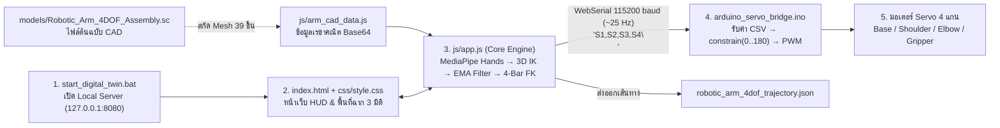

# 4-DOF Robotic Arm Digital Twin (Hand Tracking & IoT WebSerial)

> **รายวิชา:** ISY49303 IoT | **กลุ่ม:** Group 01 (`Group01_Project`)
> **ประเภทงาน:** ระบบแขนกล 4 แกน (4-Bar Parallel Linkage) แบบ Digital Twin บนเว็บ ควบคุมด้วยมือผ่านกล้องเว็บแคม (MediaPipe Hands) และส่งคำสั่งควบคุมฮาร์ดแวร์จริงแบบ Real-Time ผ่าน USB WebSerial ไปยังบอร์ด Arduino / ESP32

---

## 1. ภาพรวมเส้นทางข้อมูลของระบบ (File-Level Data Flow)

แผนภาพด้านล่างแสดงลำดับการทำงานและการส่งต่อข้อมูลระหว่างไฟล์ทั้งหมดในโปรเจกต์ตั้งแต่เปิดโปรแกรมจนถึงการขับมอเตอร์ Servo จริง:

---

## 2. ลำดับการอ่านไฟล์สำหรับผู้เริ่มต้น (Reading Roadmap)

| ลำดับ | หากคุณต้องการ... | ให้เริ่มเปิดไฟล์นี้ |
| :---: | :--- | :--- |
| **1** | **ใช้งานระบบให้ได้ทันที (Quick Start)** | อ่านคู่มือด้านล่างใน `README.md` แล้วดับเบิลคลิก `start_digital_twin.bat` |
| **2** | **เข้าใจสถาปัตยกรรม, สมการ 4-Bar IK/FK และ Data Flow ระดับฟังก์ชัน** | อ่าน [`PROJECT_DOCUMENTATION.md`](./PROJECT_DOCUMENTATION.md) |
| **3** | **แก้ไขหน้าตา UI / ปุ่มควบคุม / ธีมสี** | ดู `index.html` คู่กับ `css/style.css` (แบ่งหมวดหมู่ `01`–`05` ตรงกัน) |
| **4** | **แก้ไขลอจิก 3D, Hand Tracking, Kinematics หรือ WebSerial** | ดู `js/app.js` (มีสารบัญ `SECTION 01`–`12` อยู่ด้านบนสุดของไฟล์) |
| **5** | **แก้ไขขา Pin หรือโปรโตคอลฝั่งไมโครคอนโทรลเลอร์** | ดู `arduino_servo_bridge/arduino_servo_bridge.ino` |
| **6** | **นำโมเดลไปพิมพ์ 3 มิติ หรือจำลองใน ROS / PyBullet** | ใช้ไฟล์ในโฟลเดอร์ `models/` (`.stl`, `.glb`, `.urdf`, `.sc`) |

---

## 3. สิ่งที่ต้องเตรียมก่อนใช้งาน (Prerequisites)

* **เบราว์เซอร์:** Google Chrome หรือ Microsoft Edge เวอร์ชันล่าสุด *(จำเป็นสำหรับ WebSerial API)*
* **รันบนเครื่อง (Local):** Python 3 (สำหรับรัน `start_digital_twin.bat`)
* **ฝั่งฮาร์ดแวร์ (ถ้าต่อแขนกลจริง):** บอร์ด Arduino Uno/Nano หรือ ESP32, มอเตอร์ Servo 4 ตัว, สาย USB Data และ **แหล่งจ่ายไฟ 5V ภายนอก (2A ขึ้นไป) สำหรับเลี้ยง Servo โดยต่อกราวด์ร่วม (Common GND) กับบอร์ด**
  * *หมายเหตุสำหรับ ESP32:* ติดตั้งไลบรารี `ESP32Servo` ผ่าน Arduino Library Manager ก่อนอัปโหลด

---

## 4. คู่มือเริ่มต้นใช้งานตั้งแต่ต้นจนจบ (Step-by-Step)

### ขั้นที่ 1: อัปโหลดเฟิร์มแวร์และต่อวงจร (ข้ามได้หากทดสอบเฉพาะ 3D บนเว็บ)
1. เปิดไฟล์ `arduino_servo_bridge/arduino_servo_bridge.ino` ด้วย Arduino IDE
2. เลือกบอร์ดและพอร์ต COM ที่ถูกต้อง แล้วกด **Upload**
3. ต่อสายสัญญาณ Servo ทั้ง 4 แกนตามตารางด้านล่าง:

| ช่อง Servo | หน้าที่ข้อต่อ (DOF) | ขา Arduino (Uno/Nano) | ขา ESP32 | ท่าเริ่มต้น (Home) |
| :---: | :--- | :---: | :---: | :---: |
| **Servo 1** | Base Yaw (หมุนฐานซ้าย-ขวา) | `D3` | `GPIO 13` | `90°` |
| **Servo 2** | Shoulder Pitch (ยก-ก้มแขนท่อนบน) | `D5` | `GPIO 12` | `90°` |
| **Servo 3** | Elbow Pitch (ศอกกลไก 4-Bar) | `D6` | `GPIO 14` | `90°` |
| **Servo 4** | Gripper Claws (หัวคีบเฟืองคู่) | `D9` | `GPIO 27` | `60°` |

> **ข้อควรระวังด้านไฟฟ้า:** ห้ามดึงไฟ 5V จากขาบอร์ด Arduino/ESP32 มาเลี้ยง Servo พร้อมกันทั้ง 4 ตัว เพราะจะทำให้บอร์ดรีเซ็ตหรือพอร์ต USB ตัดการเชื่อมต่อ ให้ใช้แหล่งจ่าย 5V แยกและเชื่อมสาย `GND` เข้าด้วยกัน

### ขั้นที่ 2: เปิดระบบ Digital Twin
เลือกวิธีใดวิธีหนึ่ง:
* **วิธี A — รันบนเครื่อง Windows (แนะนำสำหรับพัฒนา):**
  ดับเบิลคลิกไฟล์ `start_digital_twin.bat` ระบบจะเปิด Local Server ที่ `http://localhost:8080` และเปิดเบราว์เซอร์ให้อัตโนมัติ
  *(หรือรันคำสั่ง `python -m http.server 8080 --bind 127.0.0.1` ในโฟลเดอร์โปรเจกต์)*
* **วิธี B — เปิดผ่าน GitHub Pages (ออนไลน์ HTTPS):**
  เปิดใช้งาน **GitHub Pages** บน Branch `main` (โฟลเดอร์ `/ (root)`) ทั้งกล้องเว็บแคม (`getUserMedia`) และ `WebSerial API` จะทำงานได้ทันทีผ่าน HTTPS

> *เหตุผลที่ห้ามเปิด `index.html` ผ่าน `file://` โดยตรง:* เบราว์เซอร์จะบล็อกสิทธิ์การเข้าถึงกล้องเว็บแคมและ WebSerial ด้วยนโยบายความปลอดภัย (Secure Context)

### ขั้นที่ 3: การควบคุมและทดสอบฟังก์ชันหลัก
1. **ควบคุมด้วยมือ (Hand Tracking):** กด **เปิดกล้อง Hand Tracking** (ประมวลผลบนเครื่อง 100% ไม่มีการส่งภาพออกภายนอก) เลือกได้ 2 โหมด:
   * `3D Inverse Kinematics`: ขยับฝ่ามือซ้าย-ขวา/ขึ้น-ลง/ใกล้-ไกล เพื่อคุมตำแหน่งปลายแขนกล และจีบนิ้วโป้ง-นิ้วชี้เพื่อหนีบ-ปล่อย
   * `Direct Joint Mapping`: คุมองศา Servo 1–4 โดยตรงจากตำแหน่งและการเอียงมือ
2. **ควบคุมด้วยตัวเลื่อน (Manual Sliders):** ปรับค่า DOF 1–4 และ Wrist Trim ที่แผงด้านขวา หรือกด `Home Pose` เพื่อกลับท่าเริ่มต้น
3. **โหมดจำลองอัตโนมัติ & บันทึกท่าทาง:** ทดลองกด **จำลอง Pick & Place**, **วาดวงกลม IK**, หรือใช้ปุ่ม **Record / Play / ส่งออก JSON** เพื่อบันทึกเส้นทางเคลื่อนที่
4. **เชื่อมต่อบอร์ดจริง (WebSerial):** ปิด Serial Monitor ใน Arduino IDE ก่อน จากนั้นกด **เชื่อมต่อ Arduino / ESP32 (WebSerial)** แล้วเลือกพอร์ต COM ของบอร์ด

### ขั้นที่ 4: การตรวจสอบและส่งออกไฟล์ 3D
* บนแผงด้านซ้ายสามารถใช้ **Exploded View**, **X-Ray**, **เส้นขอบ CAD** และคลิกที่ชิ้นส่วนใดก็ได้บนโมเดล 3D เพื่อดูข้อมูลชิ้นส่วน (39 ชิ้น)
* บนแผงด้านขวามีปุ่มดาวน์โหลดไฟล์ `.GLB`, `.STL` และ `.URDF` ที่พร้อมใช้งานทันที

---

## 5. การแก้ปัญหาเบื้องต้น (Troubleshooting)

| อาการที่พบ | สาเหตุหลัก | วิธีแก้ไข |
| :--- | :--- | :--- |
| เปิดกล้องเว็บแคมไม่ได้ | เปิดไฟล์ผ่าน `file://` หรือยังไม่อนุญาตสิทธิ์กล้อง | เปิดผ่าน `http://localhost:8080` (ใช้ `start_digital_twin.bat`) และกด Allow สิทธิ์กล้อง |
| กดปุ่ม WebSerial แล้วแจ้งไม่รองรับ | ใช้เบราว์เซอร์ที่ไม่รองรับ (เช่น Firefox / Safari) | เปลี่ยนไปเปิดด้วย **Google Chrome** หรือ **Microsoft Edge** |
| เชื่อมต่อพอร์ต COM ไม่ได้ (Failed to open serial port) | Arduino IDE เปิด Serial Monitor ค้างอยู่ | ปิดหน้าต่าง Serial Monitor ใน Arduino IDE แล้วกดเชื่อมต่อใหม่ |
| แขนกลกระตุกหรือบอร์ดหลุดการเชื่อมต่อ | แหล่งจ่ายไฟให้ Servo ไม่พอ | ใช้แหล่งจ่ายไฟ 5V แยกสำหรับ Servo และต่อ `GND` ร่วมกับบอร์ด |

---

## 6. เอกสารอ้างอิงเพิ่มเติม

สำหรับรายละเอียดเชิงเทคนิคทั้งหมด — ตารางโครงสร้างไฟล์ฉบับสมบูรณ์, เส้นทางข้อมูลระดับฟังก์ชัน (Sequence & Data Flow), สมการ 4-Bar Kinematics, พิกัดจุดหมุน, สเปกโปรโตคอล Serial และวิธีแพ็กไฟล์ส่งมอบ — สามารถอ่านต่อได้ที่:
👉 **[`PROJECT_DOCUMENTATION.md`](./PROJECT_DOCUMENTATION.md)**
