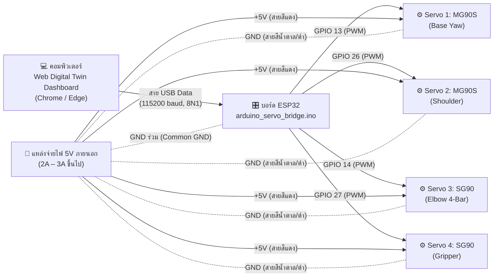

# คู่มือการต่อสายวงจรและขา Pin (Hardware Wiring Guide)

> **โปรเจกต์:** ระบบ Digital Twin ของโรงงานเพื่อควบคุมแขนกล 4-DOF ด้วย Hand Tracking และแสดงสถานะบน Dashboard (`Group01_Project` — ISY49303 IoT)  
> **เฟิร์มแวร์ที่รองรับ:** [`arduino_servo_bridge/arduino_servo_bridge.ino`](../arduino_servo_bridge/arduino_servo_bridge.ino) และ [`servo_test_esp32/servo_test_esp32.ino`](../servo_test_esp32/servo_test_esp32.ino)

---

## 1. รายการอุปกรณ์ฮาร์ดแวร์ที่ต้องเตรียม (BOM)

| ลำดับ | อุปกรณ์ | จำนวน | หมายเหตุ |
| :---: | :--- | :---: | :--- |
| 1 | บอร์ด **ESP32 Dev Module** (30-pin หรือ 38-pin) | 1 ตัว | ชิป USB-UART มักเป็น `CP210x` หรือ `CH340` |
| 2 | เซอร์โวมอเตอร์ **MG90S** (เฟืองโลหะ) | 2 ตัว | ใช้กับแกนที่รับแรงมาก: **Base (ฐาน)** และ **Shoulder (ไหล่)** |
| 3 | เซอร์โวมอเตอร์ **SG90** (เฟืองพลาสติก) | 2 ตัว | ใช้กับแกนน้ำหนักเบา: **Elbow (ศอก)** และ **Gripper (หัวคีบ)** |
| 4 | แหล่งจ่ายไฟ **5V DC (กระแส 2A–3A ขึ้นไป)** | 1 ชุด | เช่น อะแดปเตอร์ 5V 3A + หัวแปลง DC Jack หรือโมดูล Buck Converter 5V |
| 5 | สาย **USB Data** (สำหรับ ESP32) | 1 เส้น | ต้องเป็นสายที่ส่งข้อมูลได้ (ไม่ใช่สายชาร์จอย่างเดียว) |
| 6 | สายจัมเปอร์ (Male-Male / Male-Female) และ Breadboard / Terminal Block | 1 ชุด | สำหรับกระจายรางไฟ `+5V` และราง `GND` |
| 7 | ตัวเก็บประจุ Electrolytic `470µF – 1000µF` (10V ขึ้นไป) *(แนะนำ)* | 1 ตัว | ต่อคร่อมรางไฟ `+5V` และ `GND` เพื่อกันไฟตกตอน Servo ออกตัวพร้อมกัน |

---

## 2. ตารางการต่อสาย Pin อย่างละเอียด (Master Wiring Table)

### หมวด A: สายสัญญาณควบคุม PWM (ESP32 → Servo 4 ตัว)

| ต้นทาง (โมดูล/อุปกรณ์) | ขาต้นทาง | ปลายทาง (บอร์ด/อุปกรณ์) | ขาปลายทาง | หน้าที่ / หมายเหตุ |
| :--- | :--- | :--- | :--- | :--- |
| **Servo 1 — MG90S #1** (Base Yaw / หมุนฐาน) | สายสัญญาณ (**สีส้ม / เหลือง**) | บอร์ด **ESP32** | **`GPIO 13`** (`D13`) | รับสัญญาณ PWM 50 Hz ควบคุมการหมุนฐานซ้าย-ขวา (Home: `90°`) |
| **Servo 2 — MG90S #2** (Shoulder / ไหล่) | สายสัญญาณ (**สีส้ม / เหลือง**) | บอร์ด **ESP32** | **`GPIO 26`** (`D26`) | รับสัญญาณ PWM 50 Hz ควบคุมการยก-ก้มแขนท่อนบน (Home: `90°`) *(ใช้ `GPIO 26` แทน `GPIO 12` เพื่อเลี่ยง Strapping Pin)* |
| **Servo 3 — SG90 #1** (Elbow / ศอก 4-Bar) | สายสัญญาณ (**สีส้ม / เหลือง**) | บอร์ด **ESP32** | **`GPIO 14`** (`D14`) | รับสัญญาณ PWM 50 Hz ควบคุมกลไกศอก 4-Bar (Home: `90°`) |
| **Servo 4 — SG90 #2** (Gripper / หัวคีบ) | สายสัญญาณ (**สีส้ม / เหลือง**) | บอร์ด **ESP32** | **`GPIO 27`** (`D27`) | รับสัญญาณ PWM 50 Hz ควบคุมการหนีบ-ปล่อยหัวคีบ (Home cmd: `63°` → แมปช่วงปลอดภัย `20°–120°`) |

### หมวด B: ระบบไฟเลี้ยง 5V ภายนอก และกราวด์ร่วม (Power & Common GND)

| ต้นทาง (โมดูล/อุปกรณ์) | ขาต้นทาง | ปลายทาง (บอร์ด/อุปกรณ์) | ขาปลายทาง | หน้าที่ / หมายเหตุ |
| :--- | :--- | :--- | :--- | :--- |
| **แหล่งจ่ายไฟ 5V ภายนอก (2A+)** | ขั้วบวก (**`+5V`**) | รางไฟบวก (Breadboard / Terminal) | ราง **`+5V`** | จ่ายไฟหลักให้มอเตอร์ Servo ทั้ง 4 ตัว (**ห้ามต่อเข้าขา `3.3V` ของ ESP32**) |
| **แหล่งจ่ายไฟ 5V ภายนอก (2A+)** | ขั้วลบ (**`GND`**) | รางกราวด์ (Breadboard / Terminal) | ราง **`GND`** | กราวด์หลักของระบบจ่ายไฟมอเตอร์ |
| **รางกราวด์ (แหล่งจ่าย 5V)** | ราง **`GND`** | บอร์ด **ESP32** | ขา **`GND`** | **ต่อกราวด์ร่วม (Common GND)** — **จำเป็นต้องต่อ** เพื่อให้สัญญาณ PWM จาก ESP32 มีแรงดันอ้างอิงเดียวกับ Servo |
| **Servo 1 (MG90S #1)** | สายไฟเลี้ยง (**สีแดง / VCC**) | รางไฟบวก 5V ภายนอก | ราง **`+5V`** | รับไฟเลี้ยง 5V (ไม่ดึงไฟจากบอร์ด ESP32) |
| **Servo 1 (MG90S #1)** | สายกราวด์ (**สีน้ำตาล / ดำ**) | รางกราวด์ร่วม | ราง **`GND`** | ต่อครบวงจรไฟเลี้ยงและสัญญาณ |
| **Servo 2 (MG90S #2)** | สายไฟเลี้ยง (**สีแดง / VCC**) | รางไฟบวก 5V ภายนอก | ราง **`+5V`** | รับไฟเลี้ยง 5V |
| **Servo 2 (MG90S #2)** | สายกราวด์ (**สีน้ำตาล / ดำ**) | รางกราวด์ร่วม | ราง **`GND`** | ต่อครบวงจรไฟเลี้ยงและสัญญาณ |
| **Servo 3 (SG90 #1)** | สายไฟเลี้ยง (**สีแดง / VCC**) | รางไฟบวก 5V ภายนอก | ราง **`+5V`** | รับไฟเลี้ยง 5V |
| **Servo 3 (SG90 #1)** | สายกราวด์ (**สีน้ำตาล / ดำ**) | รางกราวด์ร่วม | ราง **`GND`** | ต่อครบวงจรไฟเลี้ยงและสัญญาณ |
| **Servo 4 (SG90 #2)** | สายไฟเลี้ยง (**สีแดง / VCC**) | รางไฟบวก 5V ภายนอก | ราง **`+5V`** | รับไฟเลี้ยง 5V |
| **Servo 4 (SG90 #2)** | สายกราวด์ (**สีน้ำตาล / ดำ**) | รางกราวด์ร่วม | ราง **`GND`** | ต่อครบวงจรไฟเลี้ยงและสัญญาณ |
| **ตัวเก็บประจุ `470µF–1000µF`** *(แนะนำ)* | ขาบวก (`+`) / ขาลบ (`-` แถบขาว) | รางไฟบวก 5V / รางกราวด์ | ราง **`+5V`** / ราง **`GND`** | ช่วยรักษาแรงดันไฟให้เรียบ ลดอาการกระตุกเมื่อ Servo ทำงานพร้อมกัน *(เช็กขั้ว `+`/`-` ให้ถูกต้อง)* |

### หมวด C: การเชื่อมต่อกับคอมพิวเตอร์และระบบ Dashboard

| ต้นทาง (โมดูล/อุปกรณ์) | ขาต้นทาง | ปลายทาง (บอร์ด/อุปกรณ์) | ขาปลายทาง | หน้าที่ / หมายเหตุ |
| :--- | :--- | :--- | :--- | :--- |
| **คอมพิวเตอร์ / โน้ตบุ๊ก** | พอร์ต **USB** | บอร์ด **ESP32** | พอร์ต **Micro-USB / USB-C** | จ่ายไฟเลี้ยงให้ ESP32 + สื่อสารข้อมูล WebSerial (`115200 baud, 8N1`) |
| **กล้องเว็บแคม** | USB / กล้องในเครื่อง | คอมพิวเตอร์ (Chrome / Edge) | ระบบเบราว์เซอร์ (`localhost:8080`) | รับภาพมือสำหรับ MediaPipe Hand Tracking |

---

## 3. แผนภาพสรุปการต่อวงจร (Wiring Block Diagram)

---

## 4. เช็กลิสต์ความปลอดภัยก่อนเปิดไฟใช้งานจริง (Pre-Power Checklist)

1. **เช็กสีสาย Servo ทุกตัว:**
   * **ส้ม / เหลือง** = Signal (เข้า GPIO ของ ESP32)
   * **แดง** = VCC `+5V` (เข้าแหล่งจ่าย 5V ภายนอกเท่านั้น)
   * **น้ำตาล / ดำ** = `GND` (เข้ากราวด์ร่วม)
2. **เช็ก Common GND:** ต้องมีสายเชื่อมจากขา **`GND` ของ ESP32** ไปยัง **`GND` ของแหล่งจ่ายไฟ 5V** เสมอ
3. **ห้ามต่อไฟ `+5V` ภายนอกเข้าขา `3.3V` ของ ESP32** และไม่ควรจ่ายไฟ `+5V` ภายนอกเข้าขา `VIN` พร้อมกับเสียบสาย USB หากไม่มีไดโอดกันย้อน (ให้ ESP32 รับไฟจากสาย USB และให้ Servo รับไฟจากแหล่งจ่าย 5V แยก โดยเชื่อมกันเฉพาะ `GND`)
4. **ตั้งมุมกึ่งกลางก่อนประกอบแขนกล:**
   * อัปโหลด [`servo_test_esp32.ino`](../servo_test_esp32/servo_test_esp32.ino) แล้วพิมพ์ `home` ใน Serial Monitor ให้ Servo ทุกตัวไปที่ `90°` ก่อนขันนอตก้าน Servo Horn เข้ากับโครงแขนกล
5. **อัปโหลดเฟิร์มแวร์จริงก่อนเชื่อม Dashboard:**
   * อัปโหลด [`arduino_servo_bridge.ino`](../arduino_servo_bridge/arduino_servo_bridge.ino) ลง ESP32 → **ปิด Serial Monitor** → เปิด Dashboard ผ่าน `start_digital_twin.bat` → กด **`🔌 เชื่อมต่อ Arduino / ESP32 (WebSerial)`**

---

## 5. การแก้ปัญหาการต่อสายเบื้องต้น (Wiring Troubleshooting)

| อาการที่พบ | สาเหตุที่เป็นไปได้ | วิธีแก้ไข |
| :--- | :--- | :--- |
| Servo สั่นกระตุก ไม่หมุนตามองศาที่สั่ง | ลืมต่อสาย **Common GND** ระหว่างแหล่งจ่ายไฟ 5V กับ ESP32 | เชื่อมสาย `GND` ของแหล่งจ่าย 5V เข้ากับขา `GND` ของ ESP32 |
| ขยับ Servo แล้ว ESP32 รีเซ็ต / WebSerial หลุด | ดึงไฟเลี้ยง Servo จากขาบอร์ด ESP32 หรือแหล่งจ่าย 5V กระแสไม่พอ | ใช้แหล่งจ่าย 5V ภายนอกขนาด **2A ขึ้นไป** และเพิ่ม C `470µF–1000µF` คร่อมไฟ |
| อัปโหลดโค้ดลง ESP32 ไม่ผ่าน หรือบอร์ดไม่บูต | ต่อสาย Servo ผิดไปเข้าขา Strapping Pin (เช่น `GPIO 12`) หรือกดปุ่ม BOOT ไม่ถูกจังหวะ | ตรวจสอบว่า Servo 2 ต่อที่ **`GPIO 26`** ตามตารางใหม่ (ห้ามใช้ `GPIO 12`) และกดปุ่ม `BOOT` ค้างตอนเริ่มอัปโหลดหากจำเป็น |
| ไม่พบพอร์ต COM ในเครื่อง / ใน WebSerial | ใช้สาย USB ชาร์จอย่างเดียว หรือยังไม่ได้ลงไดรเวอร์ USB-UART | เปลี่ยนเป็นสาย USB Data และติดตั้งไดรเวอร์ `CP210x` หรือ `CH340` |
