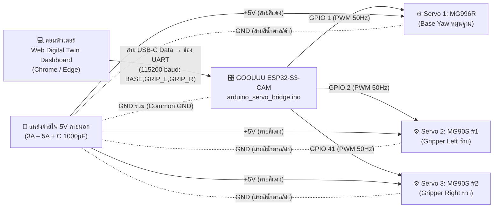

# คู่มือการต่อสายวงจรและขา Pin — GOOUUU ESP32-S3-CAM (Hardware Wiring Guide)

> **โปรเจกต์:** ระบบ Digital Twin ของโรงงานเพื่อควบคุมแขนกล 4-DOF ด้วย Hand Tracking และแสดงสถานะบน Dashboard (`Group01_Project` — ISY49303 IoT)  
> **บอร์ดควบคุมหลัก:** **GOOUUU ESP32-S3-CAM** (`ESP32-S3-WROOM-1 N16R8`, Dual USB-C)  
> **สถาปัตยกรรม Hybrid Digital Twin:** ขับมอเตอร์ Servo จริง **3 ตัว** (`1× MG996R` ที่ฐาน + `2× MG90S` แยกมือหนีบซ้าย/ขวา) ส่วนแกน Shoulder และ Elbow คงการทำงานจำลองการขยับขึ้น-ลงบน 3D Model และ Dashboard  
> **เฟิร์มแวร์ที่รองรับ:** [`arduino_servo_bridge/arduino_servo_bridge.ino`](../arduino_servo_bridge/arduino_servo_bridge.ino) และ [`servo_test_esp32/servo_test_esp32.ino`](../servo_test_esp32/servo_test_esp32.ino)

---

## 1. รายการอุปกรณ์ฮาร์ดแวร์ที่ต้องเตรียม (BOM)

| ลำดับ | อุปกรณ์ | จำนวน | หมายเหตุ |
| :---: | :--- | :---: | :--- |
| 1 | บอร์ด **GOOUUU ESP32-S3-CAM** (`ESP32-S3-WROOM-1 N16R8`) | 1 ตัว | พอร์ต USB-C คู่ — แนะนำใช้ช่อง **`UART`** (ชิป `CH343` หรือ `CP2102`) |
| 2 | เซอร์โวมอเตอร์ **MG996R** (เฟืองโลหะ แรงบิดสูง) | 1 ตัว | ใช้กับ **Base Yaw (หมุนฐาน)** (กระแสพีค 2.0A–2.5A) |
| 3 | เซอร์โวมอเตอร์ **MG90S** (เฟืองโลหะ ขนาดเล็ก) | 2 ตัว | ใช้กับ **ก้ามหนีบซ้าย (Gripper Left)** และ **ก้ามหนีบขวา (Gripper Right)** แยกข้างอิสระ |
| 4 | แหล่งจ่ายไฟ **5V DC (กระแส 3A–5A ขึ้นไป)** | 1 ชุด | เช่น อะแดปเตอร์ 5V 5A + หัวแปลง DC Jack หรือ Buck Converter 5V 5A *(จำเป็นสำหรับ MG996R)* |
| 5 | สาย **USB-C Data** | 1 เส้น | ต้องเป็นสายที่ส่งข้อมูลได้ (เสียบเข้าช่อง **`UART`** บนบอร์ด GOOUUU) |
| 6 | สายจัมเปอร์ (Male-Male / Male-Female) และ Breadboard / Terminal Block | 1 ชุด | สำหรับกระจายรางไฟ `+5V` และราง `GND` |
| 7 | ตัวเก็บประจุ Electrolytic **`1000µF`** (10V–16V ขึ้นไป) *(แนะนำอย่างยิ่ง)* | 1 ตัว | ต่อคร่อมรางไฟ `+5V` และ `GND` เพื่อกันไฟตกตอน MG996R ออกตัว |

---

## 2. ตารางการต่อสาย Pin อย่างละเอียด (Master Wiring Table)

### หมวด A: สายสัญญาณควบคุม PWM (GOOUUU ESP32-S3-CAM → Servo จริง 3 ตัว)

> **ทำไมจึงเลือกขา `GPIO 1`, `GPIO 2`, `GPIO 41`?**  
> บนบอร์ด **GOOUUU ESP32-S3-CAM** ขา `GPIO 4–13, 15–18` ถูกใช้กับกล้อง, `GPIO 26–32` และ `35–37` ถูกจองให้ Internal Flash / Octal PSRAM (ไม่มีบน Header หรือห้ามใช้), `GPIO 38–40` ใช้กับช่อง MicroSD, `GPIO 19–20` ใช้กับ Native USB, `GPIO 43–44` ใช้กับ UART0 และ `GPIO 0, 3, 45, 46` เป็น Strapping Pins จึงเลือกใช้ **`GPIO 1, 2, 41`** ที่ว่างสะอาด 100% *(ขาสำรองที่ว่างเพิ่มเติม: `GPIO 14`, `GPIO 42`, `GPIO 47`)*

| ต้นทาง (มอเตอร์จริง) | ขาต้นทาง | ปลายทาง (บอร์ด) | ขาปลายทาง | หน้าที่ / หมายเหตุ |
| :--- | :--- | :--- | :--- | :--- |
| **Servo 1 — MG996R** (Base Yaw / หมุนฐาน) | สายสัญญาณ (**สีส้ม / เหลือง**) | **GOOUUU ESP32-S3-CAM** | **`GPIO 1`** | รับสัญญาณ PWM 50 Hz (`500–2400 µs`) หมุนฐานซ้าย-ขวา (Home: `90°`) |
| **Servo 2 — MG90S #1** (Gripper Left / ก้ามหนีบซ้าย) | สายสัญญาณ (**สีส้ม / เหลือง**) | **GOOUUU ESP32-S3-CAM** | **`GPIO 2`** | รับสัญญาณ PWM 50 Hz คุมก้ามหนีบซ้าย (Home cmd: `63°` → HW `20°–120°`) |
| **Servo 3 — MG90S #2** (Gripper Right / ก้ามหนีบขวา) | สายสัญญาณ (**สีส้ม / เหลือง**) | **GOOUUU ESP32-S3-CAM** | **`GPIO 41`** | รับสัญญาณ PWM 50 Hz คุมก้ามหนีบขวา (Invert สมมาตรในเฟิร์มแวร์ • Home cmd: `63°`) |
| *(แกน Shoulder & Elbow)* | *(Virtual / Digital Twin Only)* | — | — | คงการทำงานขยับขึ้น-ลงบนโมเดล 3D, Hand Tracking และ Dashboard (ไม่ต่อมอเตอร์) |

### หมวด B: ระบบไฟเลี้ยง 5V ภายนอก (3A–5A) และกราวด์ร่วม (Power & Common GND)

| ต้นทาง (โมดูล/อุปกรณ์) | ขาต้นทาง | ปลายทาง (บอร์ด/อุปกรณ์) | ขาปลายทาง | หน้าที่ / หมายเหตุ |
| :--- | :--- | :--- | :--- | :--- |
| **แหล่งจ่ายไฟ 5V ภายนอก (3A–5A+)** | ขั้วบวก (**`+5V`**) | รางไฟบวก (Terminal / Breadboard) | ราง **`+5V`** | จ่ายไฟหลักให้ MG996R + 2×MG90S (**ห้ามต่อเข้าขา `3.3V` ของบอร์ด**) |
| **แหล่งจ่ายไฟ 5V ภายนอก (3A–5A+)** | ขั้วลบ (**`GND`**) | รางกราวด์ (Terminal / Breadboard) | ราง **`GND`** | กราวด์หลักของระบบจ่ายไฟมอเตอร์ |
| **รางกราวด์ (แหล่งจ่าย 5V)** | ราง **`GND`** | **GOOUUU ESP32-S3-CAM** | ขา **`GND`** | **ต่อกราวด์ร่วม (Common GND)** — **จำเป็นต้องต่อ** เพื่อให้สัญญาณ PWM อ้างอิงแรงดันเดียวกัน |
| **Servo 1 (MG996R — Base)** | สายไฟเลี้ยง (**แดง**) / กราวด์ (**น้ำตาล/ดำ**) | ราง **`+5V`** / ราง **`GND`** | รางไฟภายนอก | ห้ามดึงไฟจากพอร์ต USB ของบอร์ดเด็ดขาด |
| **Servo 2 (MG90S #1 — Gripper L)** | สายไฟเลี้ยง (**แดง**) / กราวด์ (**น้ำตาล/ดำ**) | ราง **`+5V`** / ราง **`GND`** | รางไฟภายนอก | รับไฟ 5V ภายนอก |
| **Servo 3 (MG90S #2 — Gripper R)** | สายไฟเลี้ยง (**แดง**) / กราวด์ (**น้ำตาล/ดำ**) | ราง **`+5V`** / ราง **`GND`** | รางไฟภายนอก | รับไฟ 5V ภายนอก |
| **ตัวเก็บประจุ `1000µF` (10V+)** *(แนะนำ)* | ขาบวก (`+`) / ขาลบ (`-` แถบขาว) | ราง **`+5V`** / ราง **`GND`** | คร่อมรางไฟ | ลดอาการไฟตก/กระตุกเมื่อ MG996R ออกตัว *(เช็กขั้ว `+`/`-` ให้ถูกต้อง)* |

### หมวด C: การเชื่อมต่อกับคอมพิวเตอร์ (Dual USB-C)

| ต้นทาง | ขาต้นทาง | ปลายทาง | ขาปลายทาง | หน้าที่ / หมายเหตุ |
| :--- | :--- | :--- | :--- | :--- |
| **คอมพิวเตอร์ / โน้ตบุ๊ก** | พอร์ต **USB** | **GOOUUU ESP32-S3-CAM** | ช่อง USB-C **`UART`** *(แนะนำ)* | จ่ายไฟเลี้ยงบอร์ด + อัปโหลดโค้ด + WebSerial (`115200 baud, 8N1`) ผ่าน `CH343` / `CP2102` |
| **กล้องเว็บแคม** | USB / กล้องในเครื่อง | คอมพิวเตอร์ (Chrome / Edge) | เบราว์เซอร์ (`localhost:8080`) | รับภาพมือสำหรับ MediaPipe Hand Tracking |

---

## 3. แผนภาพสรุปการต่อวงจร (Wiring Block Diagram)

---

## 4. การตั้งค่า Arduino IDE สำหรับ GOOUUU ESP32-S3-CAM

1. ติดตั้ง Board Package **`esp32` by Espressif Systems (v3.x)** และไลบรารี **`ESP32Servo` (v3.0.5+)**
2. เสียบสาย USB-C Data เข้าช่อง **`UART`** ของบอร์ด (ติดตั้งไดรเวอร์ **`CH343`** หากไม่ขึ้นพอร์ต COM)
3. ตั้งค่าในเมนู **Tools**:
   * **Board:** `ESP32S3 Dev Module`
   * **Flash Size:** `16MB (128Mb)` *(สำหรับรุ่น N16R8)*
   * **PSRAM:** `OPI PSRAM` *(สำหรับรุ่น R8)*
   * **USB CDC On Boot:** `Disabled` *(เมื่อเสียบช่อง `UART`)* หรือ `Enabled` *(หากเสียบช่อง `USB` Native)*
4. อัปโหลด [`servo_test_esp32.ino`](../servo_test_esp32/servo_test_esp32.ino) พิมพ์ `home` และ `grip 50` เพื่อตรวจทิศทางก้ามหนีบซ้าย/ขวา จากนั้นอัปโหลด [`arduino_servo_bridge.ino`](../arduino_servo_bridge/arduino_servo_bridge.ino) → **ปิด Serial Monitor** → เปิดเว็บผ่าน `start_digital_twin.bat` แล้วกด **`🔌 เชื่อมต่อ GOOUUU ESP32-S3-CAM (WebSerial)`**

---

## 5. การแก้ปัญหาเบื้องต้น (Wiring Troubleshooting)

| อาการที่พบ | สาเหตุที่เป็นไปได้ | วิธีแก้ไข |
| :--- | :--- | :--- |
| Servo สั่นกระตุก ไม่หมุนตามองศาที่สั่ง | ลืมต่อสาย **Common GND** ระหว่างแหล่งจ่าย 5V กับบอร์ด | เชื่อมสาย `GND` ของแหล่งจ่าย 5V เข้ากับขา `GND` ของ GOOUUU ESP32-S3-CAM |
| หมุนฐาน (MG996R) แล้วบอร์ดรีเซ็ต / USB หลุด | แหล่งจ่าย 5V กระแสไม่พอ หรือดึงไฟจากพอร์ต USB | ใช้แหล่งจ่าย 5V ภายนอก **3A–5A ขึ้นไป** และต่อ C `1000µF` คร่อมรางไฟ |
| ก้ามหนีบซ้าย-ขวาหมุนไปทางเดียวกันแทนที่จะหนีบเข้าหากัน | ทิศทางการติดฮอร์นมอเตอร์ฝั่งขวาตรงข้ามกับค่าเริ่มต้น | แก้ `INVERT_SERVO_GRIP_R` ใน `arduino_servo_bridge.ino` (`true` ↔ `false`) |
| ไม่พบพอร์ต COM ในเครื่อง / อัปโหลดไม่ผ่าน | เสียบผิดช่อง USB-C หรือยังไม่ได้ลงไดรเวอร์ `CH343` | เสียบช่อง **`UART`**, ลงไดรเวอร์ `CH343`, หากอัปโหลดไม่ผ่านให้กดปุ่ม `BOOT` ค้าง + กด `RST` 1 ครั้งแล้วปล่อย `BOOT` |
